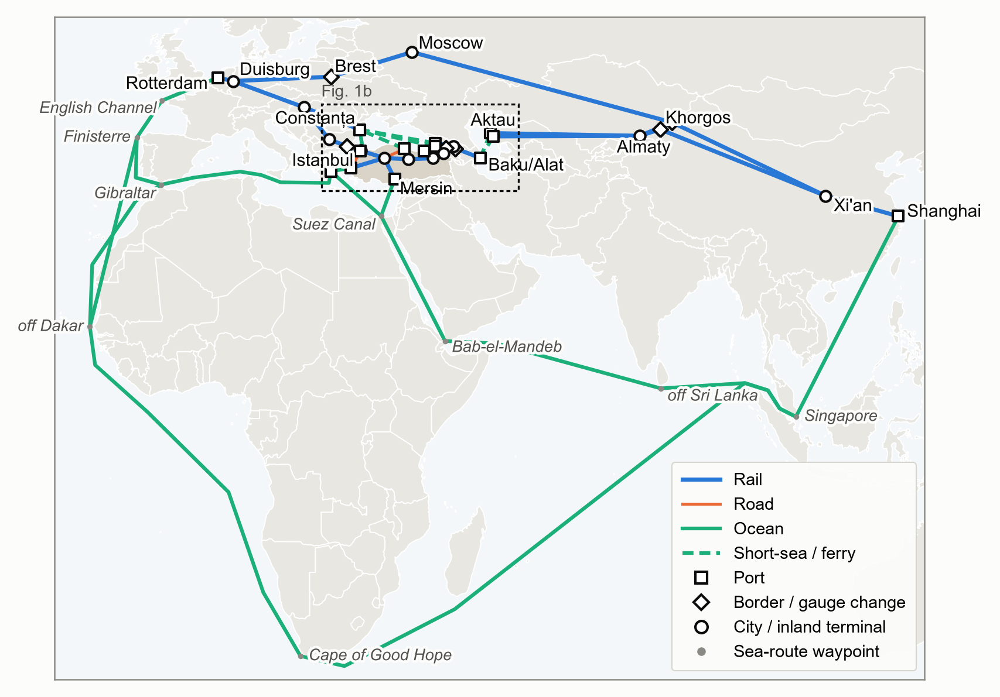
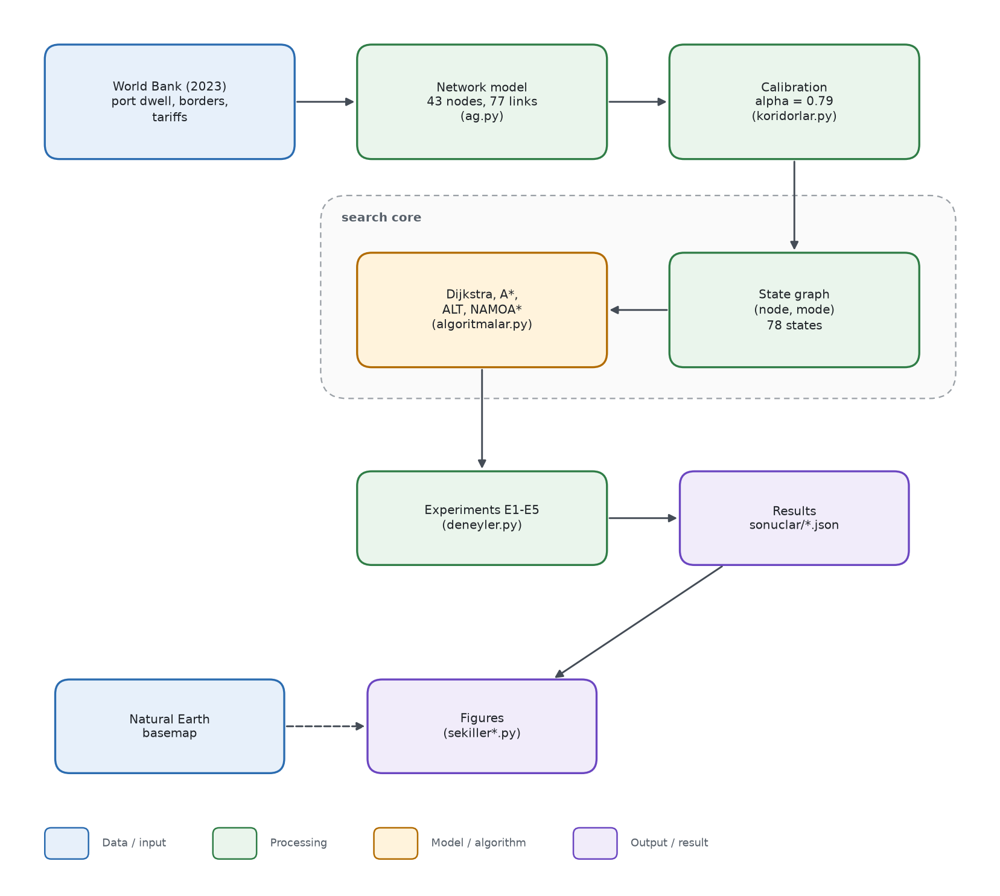
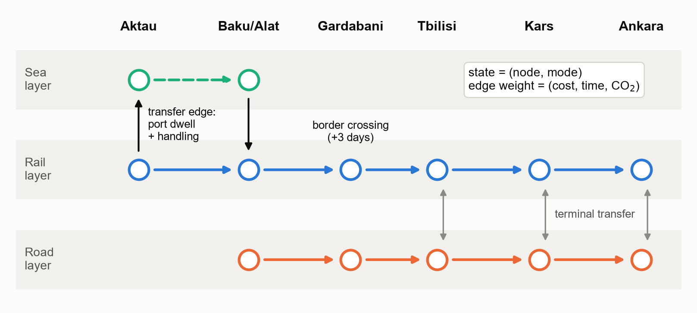
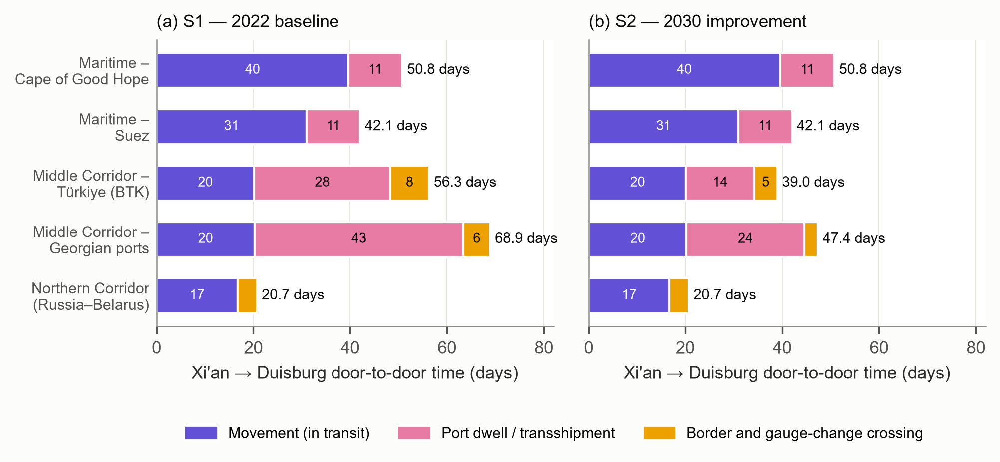
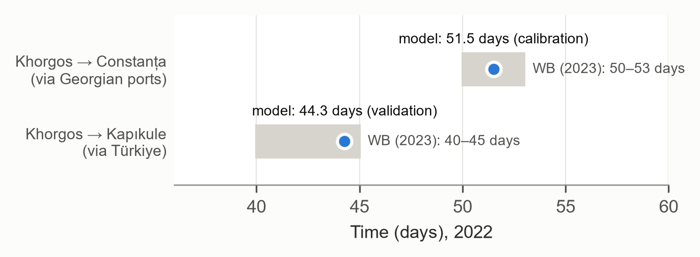
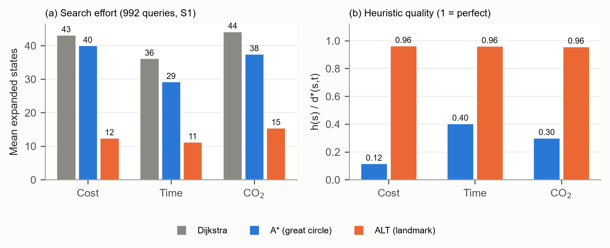
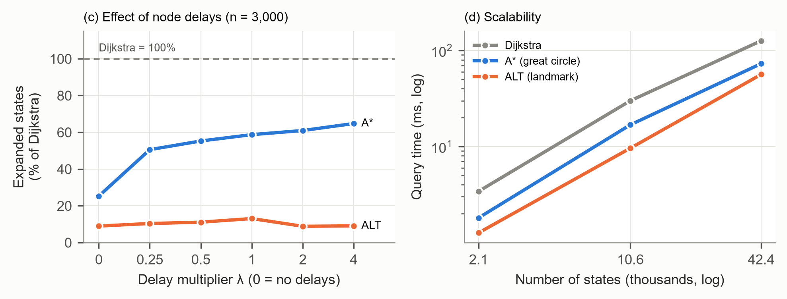
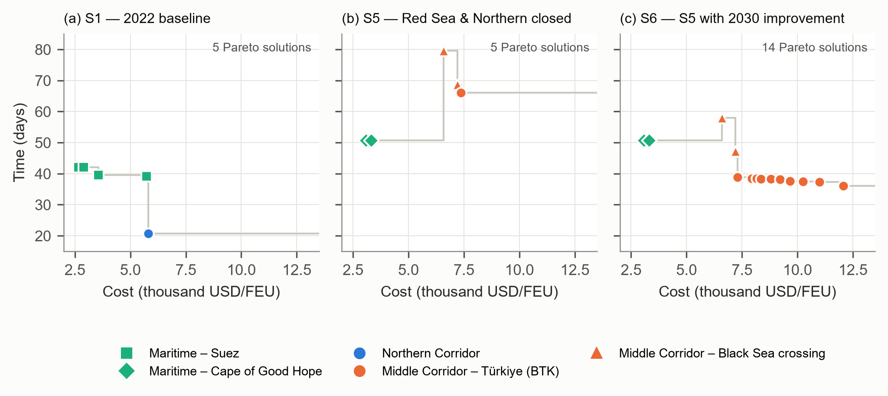

# Middle Corridor Route Planning

**Multimodal Asia–Europe route planning via the Türkiye land bridge with Dijkstra, A\*, ALT and NAMOA\* search.**

A 43-node rail–road–ocean–short-sea network from China to Europe, calibrated with the World Bank's 2023 Middle Corridor data.
Routes are optimised for cost, transit time and CO₂ across six disruption and 2030-target scenarios. Every search algorithm is implemented from scratch in plain Python.



*The full network: rail (blue), road (orange), ocean and short-sea/ferry (green). The dashed box is the Türkiye–Caucasus section shown in `plots/turkiye_section.png`.*

## Overview

| | |
|---|---|
| **Problem** | Which corridor and mode chain is best for an Asia–Europe container when port dwell and border delays dominate travel time, and how well do A\*-family heuristics cope with such node delays? |
| **Method** | Multilayer state graph (node, mode) with cost/time/CO₂ edge vectors; Dijkstra, A\* with a great-circle heuristic, ALT (landmarks) and multi-objective NAMOA\*; six scenarios (2022 baseline, 2030 target, Red Sea and/or Northern Corridor closed) |
| **Simulation / hardware** | Deterministic network model, no simulator. Python 3.12.10 + matplotlib 3.11.1 on Windows 11 Pro, AMD Ryzen 7 8845HS, 15 GB RAM (CPU only) |
| **Paper** | In preparation (*Artificial Intelligence in Applied Sciences*) |

### System architecture



World Bank port, border and tariff figures parameterise the network (`ag.py`), and a single dwell-scaling factor α is calibrated on the Khorgos–Constanța route (`koridorlar.py`). The network becomes a state graph in which every node–mode pair is a state. The four search algorithms (`algoritmalar.py`) run on it inside five experiments (`deneyler.py`), whose JSON outputs drive the figures.



## Selected results

### Result 1: Waiting at ports and borders dominates the Middle Corridor

Under 2022 conditions, 48.7 of 68.9 days on the Georgian-ports branch and 36.1 of 56.3 days on the Türkiye (BTK) branch are port and border waiting. If the 2030 target (waits halved) is met, the Türkiye branch drops to 39.0 days and overtakes the Suez sea route (42.1 days).



### Result 2: The model reproduces an independent World Bank route

α = 0.79 is fitted on Khorgos–Constanța (51.5 days). The Khorgos–Kapıkule route through Türkiye, which was not used in calibration, comes out at 44.3 days, inside the reported 40–45 days. Modelled cost is above the reported range (3,824 vs 2,500–3,250 USD/FEU on Khorgos–Constanța), so costs are read comparatively.



### Result 3: Landmarks (ALT) fix what the distance heuristic cannot see

On the real network (992 queries) the great-circle heuristic predicts only 12–40% of the true remaining cost, while ALT predicts 96% and expands about one third of Dijkstra's states. On synthetic networks A\* expands 25% of Dijkstra's states without delays but 50–65% once node delays are added; ALT stays at 9–13%.

<table><tr>
<td></td>
<td></td>
</tr></table>

### Result 4: Closures and the 2030 target widen the Pareto front

NAMOA\* finds 5 Pareto-optimal routes in S1 and S5 but 14 in S6 (both alternatives closed plus the 2030 target), where Türkiye-branch mode mixes enter the front. On that front the all-road variant saves 2.7 days over all-rail BTK at 65% higher cost.



*All figures are in `plots/`.*

## Installation

### Requirements

- Windows, Linux or macOS (tested on Windows 11 Pro)
- Python 3.10 or newer (tested with 3.12.10)
- matplotlib only; no GPU, under 1 GB RAM

### Steps

```bash
git clone https://github.com/BalBaZeuR0/MiddleCorridor-RoutePlan.git
cd MiddleCorridor-RoutePlan
python -m venv .venv && source .venv/bin/activate   # Windows: .venv\Scripts\activate
pip install -r requirements.txt
cd model
python deneyler.py e1          # installation check, a few seconds
```

Expected output (the code prints in Turkish: "E1 done: 72 rows; Dijkstra and A\* returned the same optimum in every query"):

```
E1 tamam: 72 satır; Dijkstra ve A* tüm sorgularda aynı optimum değeri verdi.
```

## Usage

### Run all six experiments

```bash
cd model
python deneyler.py              # E1-E6, about 47 s on the machine above; or e.g. python deneyler.py e2 e3
```

Expected output, first lines (E2: Pareto solutions and labels expanded without → with the heuristic):

```
E1 tamam: 72 satır; Dijkstra ve A* tüm sorgularda aynı optimum değeri verdi.
E2 S1: 5 Pareto çözüm; etiket genişletme 173 → 104
E2 S2: 5 Pareto çözüm; etiket genişletme 217 → 134
E2 S5: 5 Pareto çözüm; etiket genişletme 358 → 225
E2 S6: 14 Pareto çözüm; etiket genişletme 447 → 383
```

and the last lines:

```
E4 ölçek n=20000: D 20196 (124.8 ms) A* 10522 (75.3 ms) ALT 2714 (57.5 ms) ön 10992 ms
E5: 144 deneme, rota değişen: 6
E6: { ... "S2_btk_suveysten_hizli": 0.6945, "S6_btk_en_hizli": 0.9595, ... "basabas_bekleme_azalimi": 0.4113 }
```

Results are written to `sonuclar/e1_rotalar.json` … `e6_saglamlik.json` (E6: joint ±30% Monte Carlo robustness of the corridor ranking, 2,000 draws, fixed seed). The committed JSON files are the ones used in the paper. Query times vary between machines, and because Python randomises set ordering, tie-breaking between equal-cost states can change averaged expansion counts in the second decimal (for example 15.48 → 15.46 for ALT on CO₂); optimal values, routes and Pareto sets are identical.

## Reproducing the results

Figures are written to `sekiller/` (git-ignored); the README copies in `plots/` and `assets/` carry the names below. `SEKIL_DIL=en` selects English labels (Windows PowerShell: `$env:SEKIL_DIL="en"`). The scripts use the Arial font when available.

| Figure | Command |
|---|---|
| `assets/network_map.png` | `cd model && SEKIL_DIL=en python sekiller.py genel` |
| `plots/turkiye_section.png` | `cd model && SEKIL_DIL=en python sekiller.py turkiye` |
| `plots/state_graph.png` | `cd model && SEKIL_DIL=en python sekiller.py durum` |
| `plots/time_breakdown.png` | `cd model && SEKIL_DIL=en python sekiller.py kirilim` |
| `plots/calibration.png` | `cd model && SEKIL_DIL=en python sekiller.py kalibrasyon` |
| `plots/pareto_fronts.png` | `cd model && SEKIL_DIL=en python sekiller_sonuc.py pareto` |
| `plots/efficiency_real.png` | `cd model && SEKIL_DIL=en python sekiller_sonuc.py verimlilik` |
| `plots/efficiency_synthetic.png` | `cd model && SEKIL_DIL=en python sekiller_sonuc.py sentetik` |
| `assets/architecture.png` | `python scripts/flowchart.py assets/architecture.json` |

## Project structure

```
MiddleCorridor-RoutePlan/
├── assets/          # README images: network map, architecture diagram (+ .json source)
├── model/           # source code (identifiers and comments in Turkish)
│   ├── ag.py            # nodes, links, parameters, scenarios, state-graph builder
│   ├── koridorlar.py    # reference corridors and alpha calibration
│   ├── algoritmalar.py  # Dijkstra, A*, ALT, landmark selection, NAMOA*
│   ├── deneyler.py      # experiments E1-E6 and synthetic networks
│   ├── sekiller.py      # maps, state graph, time breakdown, calibration figures
│   ├── sekiller_sonuc.py# Pareto, efficiency and synthetic-network figures
│   └── ceviri_en.py     # English labels for the figures (SEKIL_DIL=en)
├── plots/           # result figures used in this README
├── scripts/         # flowchart.py (architecture diagram)
├── sonuclar/        # experiment outputs (JSON) used in the paper
├── veri_harici/     # Natural Earth 1:50m country polygons (public domain), basemap only
├── requirements.txt
├── LICENSE
└── README.md
```

Data sources: port dwell, handling, border-crossing and tariff values are taken from World Bank (2023), *Middle Trade and Transport Corridor: Policies and Investments to Triple Freight Volumes and Halve Travel Time by 2030*, and are entered as parameters in `model/ag.py`; the report itself is not redistributed here. CO₂ intensities are typical values within the GLEC Framework v3.0.

## Citation, license, contact

```bibtex
@misc{cetinoglu2026middlecorridor,
  title  = {Multimodal Asia--Europe Route Planning via the T{\"u}rkiye Land Bridge:
            A Comparison of Dijkstra, A*, ALT and NAMOA* Search Algorithms},
  author = {{\c{C}}etino{\u{g}}lu, Hakan and {\"O}zkurt, Cem and Onay, Muhammed Emin and
            Topal, Ey{\"u}p Alperen and {\"O}zt{\"u}rk, Emir},
  year   = {2026},
  howpublished = {\url{https://github.com/BalBaZeuR0/MiddleCorridor-RoutePlan}}
}
```

MIT License (see `LICENSE`). Contact: [@BalBaZeuR0](https://github.com/BalBaZeuR0).
